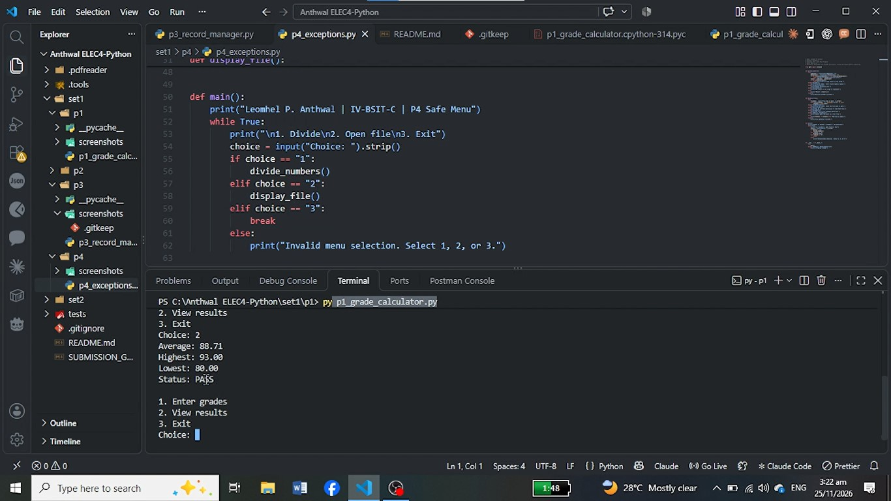
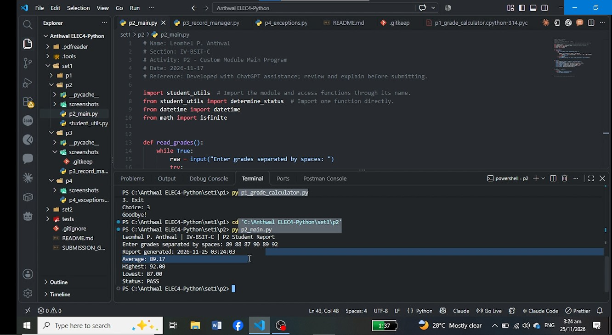
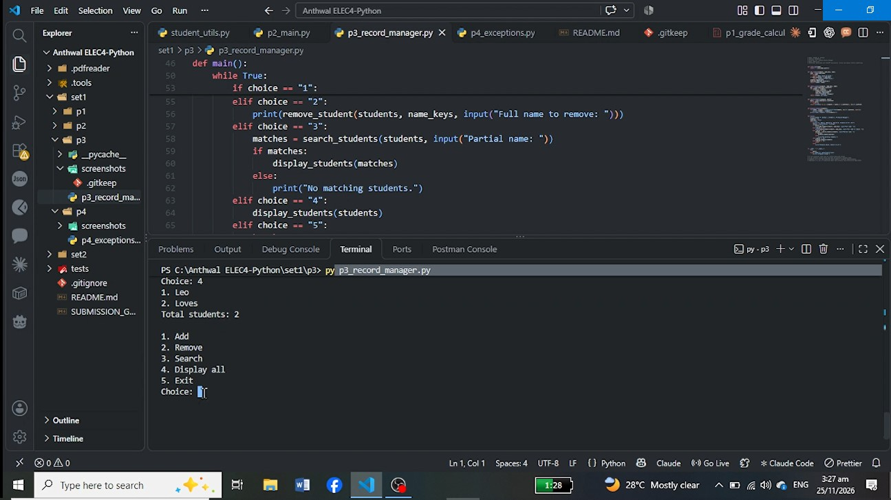
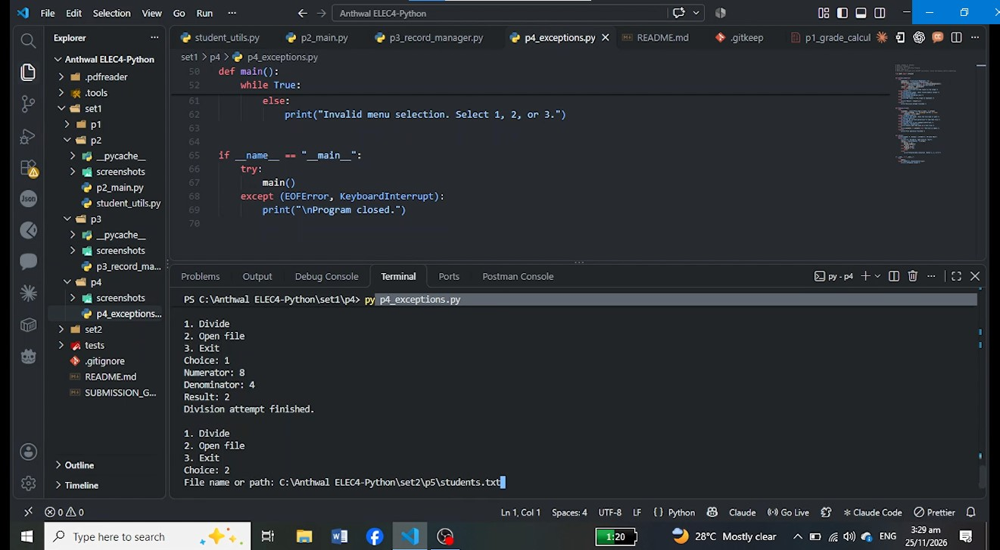
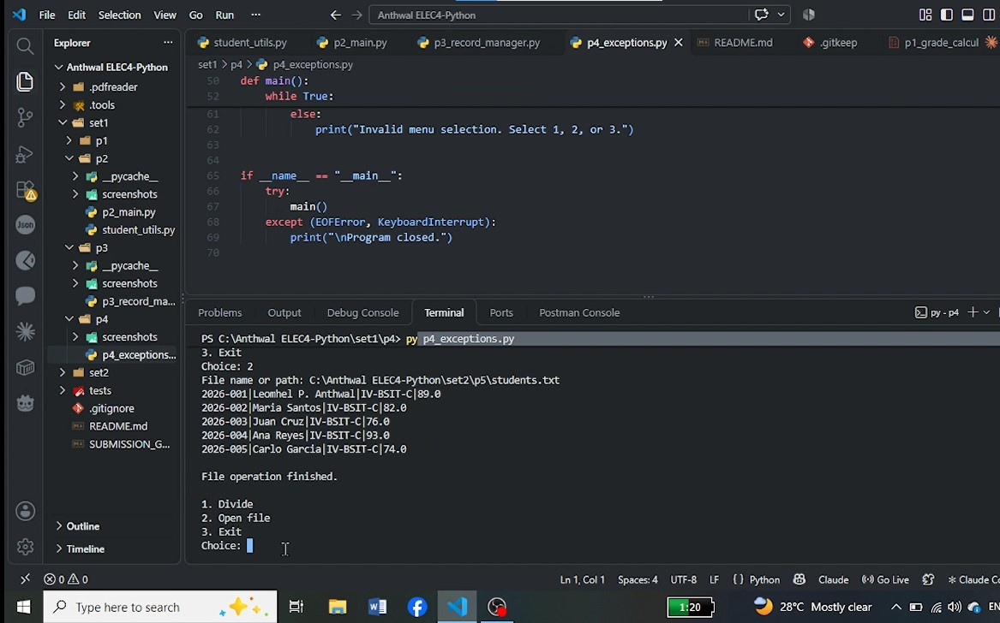

# ELEC 4 - Python Programming

Leomhel P. Anthwal | IV-BSIT-C

## Set 1

### P1 — Student Grade Calculator

[Activity folder](set1/p1/) — Enter grades and view the average, highest, lowest, and pass/fail result.

Run from the repository root with `py set1/p1/p1_grade_calculator.py`.

### P2 — Student Report

[Activity folder](set1/p2/) — Generates a timestamped grade report using the `student_utils` module.

Run from the repository root with `py set1/p2/p2_main.py`.

### P3 - Student Record Manager

[Activity folder](set1/p3/) - Add, remove, search, and display student names.

Run from the repository root with `py set1/p3/p3_record_manager.py`.

### P4 - Safe Menu Program

[Activity folder](set1/p4/) - Divides numbers and opens text files with error handling.

Run from the repository root with `py set1/p4/p4_exceptions.py`.

